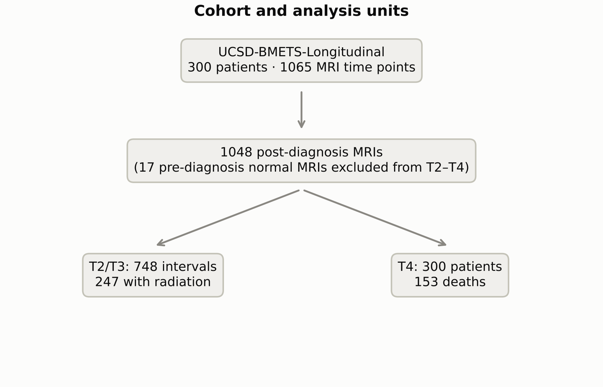

# bmets-forecast

**Forecasting intracranial disease evolution in brain metastases from longitudinal multiparametric MRI with 3D foundation models.**

Dataset: [UCSD-BMETS-Longitudinal](https://doi.org/10.7937/5ejb-9g94) (TCIA, October 2026): 300 patients, 1,065 MRI time points, neuroradiologist-approved segmentations, CC BY 4.0.

| Task | Question |
|---|---|
| T1 | Automated segmentation (nnU-Net S0 vs. prior-conditioned S2) and lesion tracking |
| **T2 (primary)** | Will the next MRI show intracranial progression (T2a) or a new metastasis (T2b)? |
| T3 | How much will each lesion grow or shrink? |
| T4 | Overall survival (153 deaths) |

Models compared, all on identical patient-level folds:
- clinical burden (P0);
- radiomics + LightGBM (P1);
- foundation-model linear probe (P2);
- temporal transformer over foundation-model embeddings (P3);
- fusion (P5).

All explainability figures (SHAP, integrated gradients, Grad-CAM, attention, ablation) are generated automatically.

> Research prototype. **Not a medical device.**

## Quick start (no data needed)

```bash
pip install -e ".[test]" torch lifelines
pytest -q          # ~100 tests on a synthetic longitudinal cohort, incl. an end-to-end CLI run
```

## Run on real data

- **UTD Juno (SLURM):** [`juno/README_JUNO.md`](juno/README_JUNO.md)
- **Google Colab + Drive:** [`colab/README_COLAB.md`](colab/README_COLAB.md)

Pipeline: `bmf audit → index → splits → preprocess → seg-export/nnU-Net → track → labels → features → embed → train → evaluate → explain → figures → report → (lock → external)`.

## Documents

| | |
|---|---|
| Guide (PDF, illustrated) | [`docs/guide/bmets_forecast_guide.pdf`](docs/guide/bmets_forecast_guide.pdf) |
| Design spec / plan | [`docs/specs/`](docs/specs) · [`docs/plans/`](docs/plans) |
| Pre-specified analysis plan (frozen, SHA-256) | [`docs/analysis_plan.md`](docs/analysis_plan.md) |
| Manuscript skeleton (npj Digital Medicine) | [`docs/manuscript/manuscript.md`](docs/manuscript/manuscript.md) |
| TRIPOD+AI / CLAIM | [`docs/TRIPOD_AI_checklist.md`](docs/TRIPOD_AI_checklist.md) · [`docs/CLAIM_checklist.md`](docs/CLAIM_checklist.md) |
| Model card | [`MODEL_CARD.md`](MODEL_CARD.md) |

## Cohort audit (from the public TSVs)

300 patients · 1,065 time points · 748 post-diagnosis intervals (247 with radiation) · 153 deaths. Primary tumours: lung 113, breast 78, melanoma 27, gastrointestinal 22, renal 17, prostate 7, other 36. Scanners: 3T 635 / 1.5T 430.



## Citation

Data: Correia de Verdier M, et al. (2026) UCSD-BMETS-Longitudinal (v1). The Cancer Imaging Archive. https://doi.org/10.7937/5ejb-9g94
