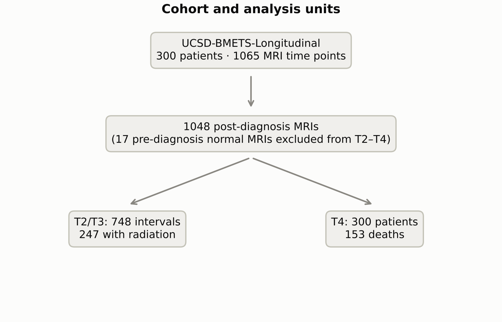
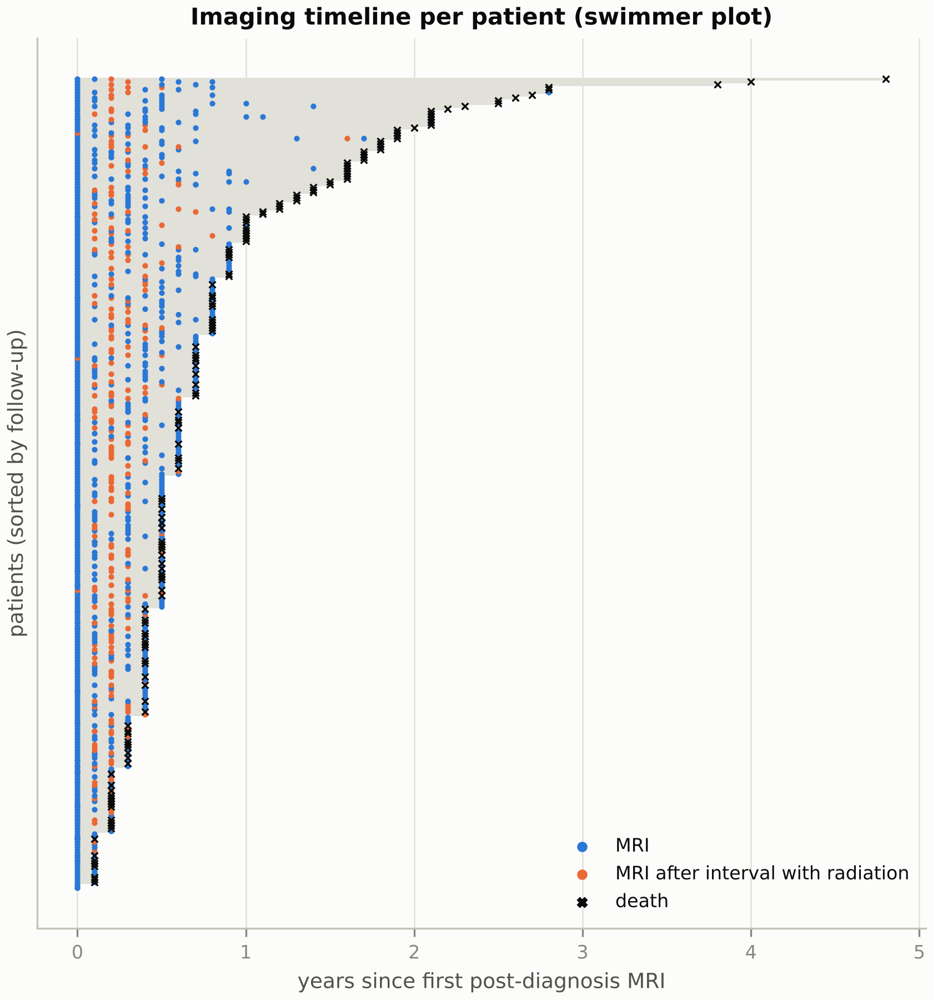
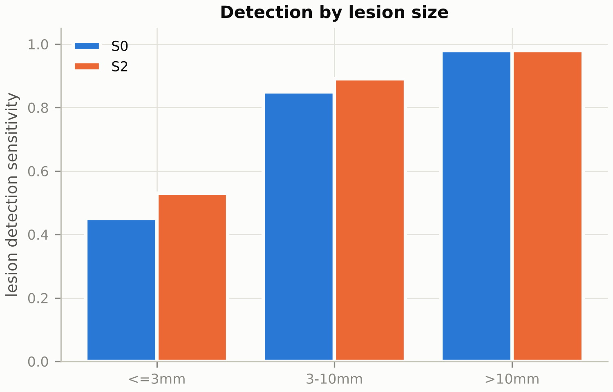
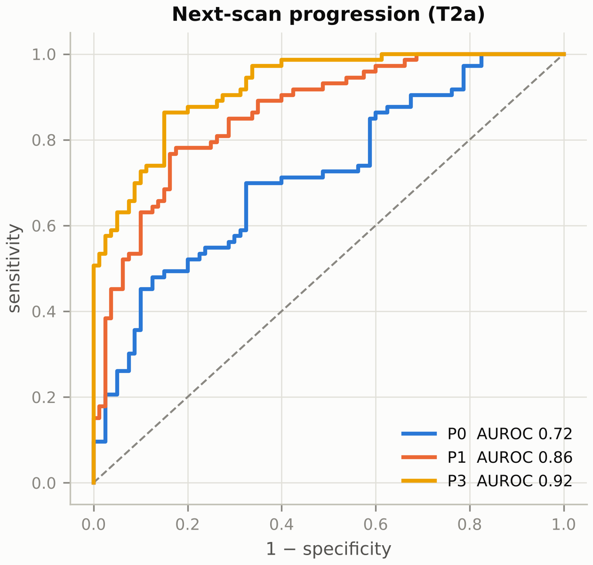
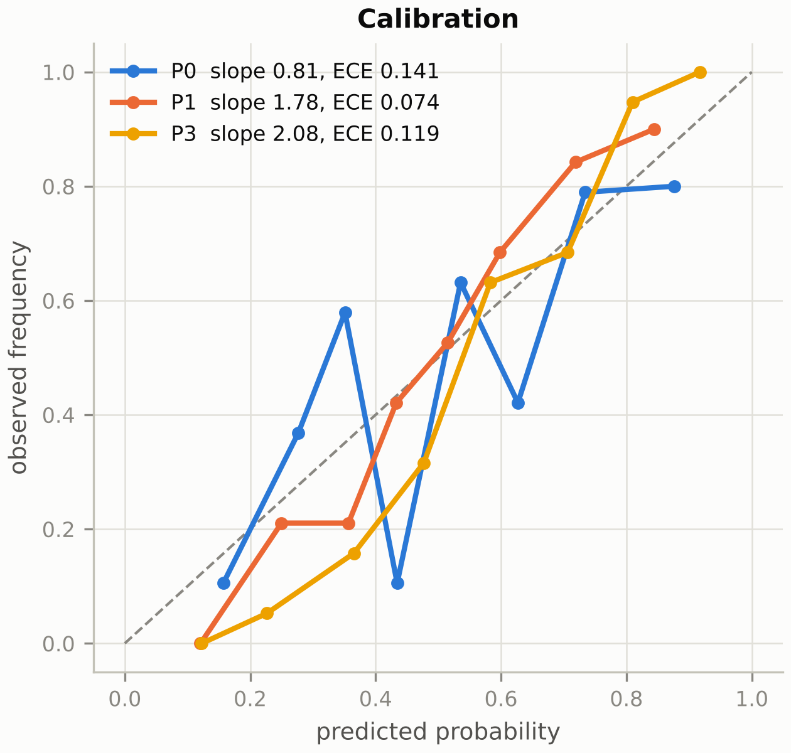
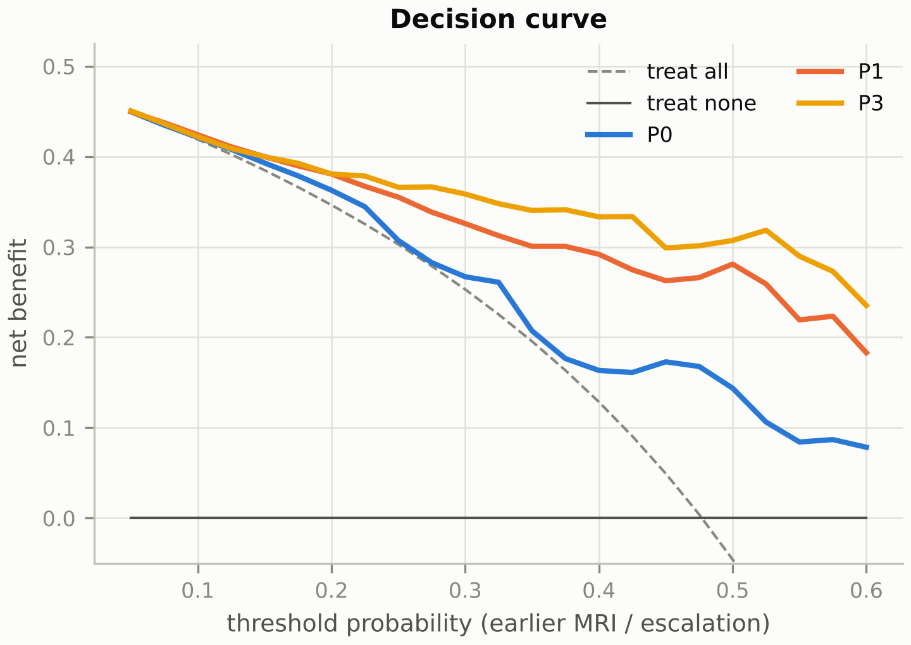
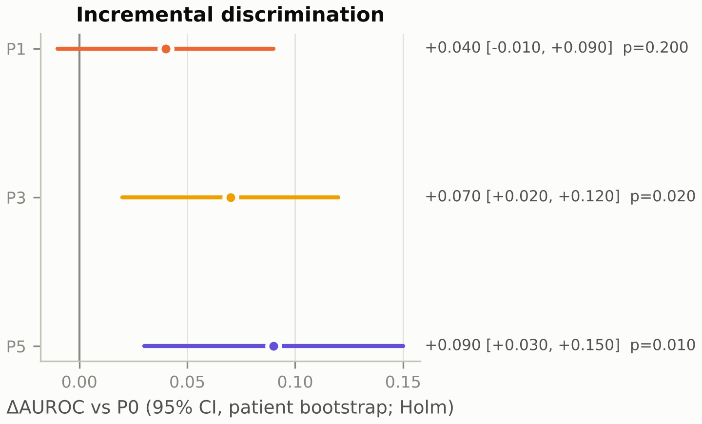
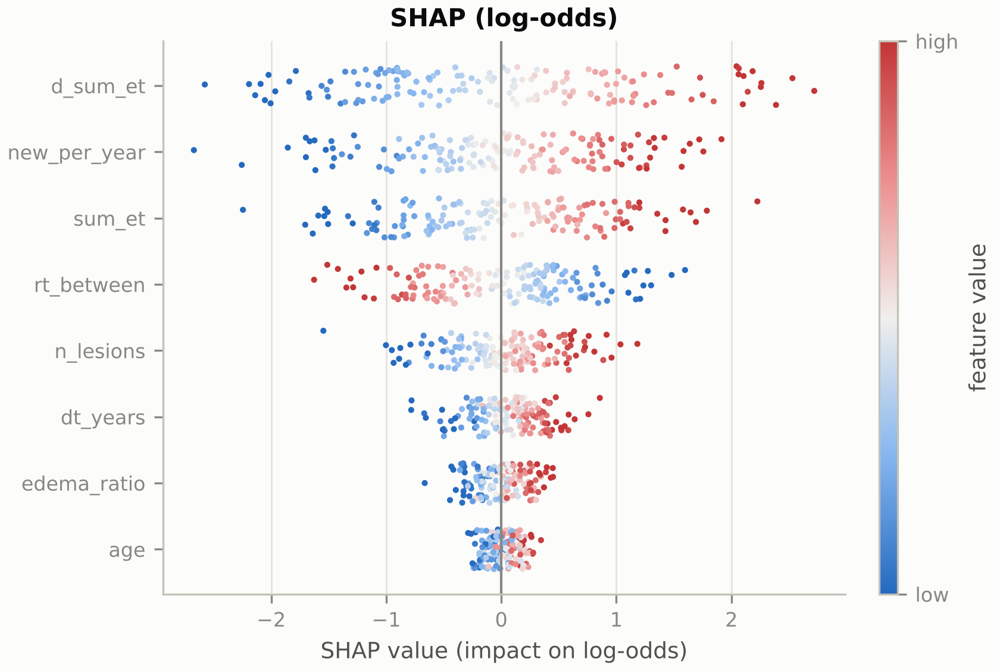
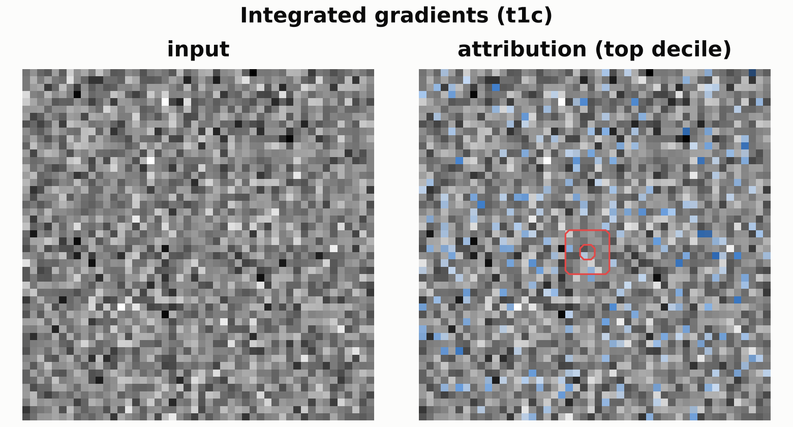
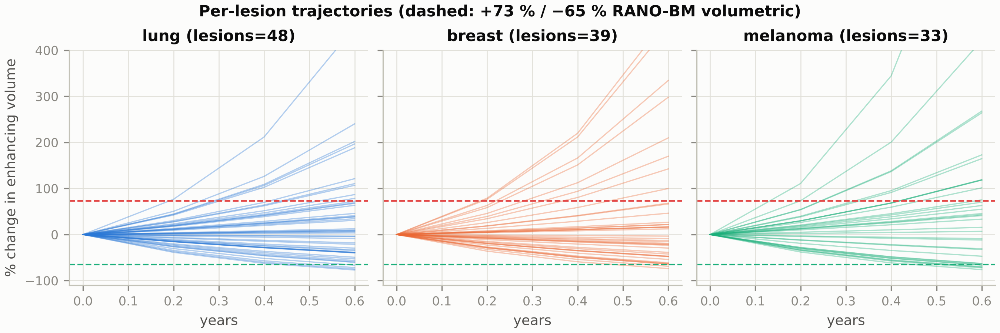

# Forecasting intracranial disease evolution in brain metastases from longitudinal multiparametric MRI with 3D foundation models

**Rittik Patra**¹

¹ Department of Bioengineering, The University of Texas at Dallas, Richardson, TX, USA

*Target journal: npj Digital Medicine (Article). Placeholders `{{…}}` are filled from `reports/results.json` with `docs/manuscript/fill_manuscript.py`. `[pending: …]` marks results not yet computed. Figures marked "placeholder" point to synthetic examples until the real run replaces them with `reports/figures/*`.*

---

## Abstract

<!-- npj DM: ≤150 words, unstructured, no references -->

Brain metastases are managed by serial MRI, yet clinicians cannot anticipate which patients will develop new lesions or progress before the next scan.

Using UCSD-BMETS-Longitudinal, a public cohort of {{cohort.n_patients}} patients with {{cohort.n_timepoints}} MRI time points, we built a fully automated pipeline:
- longitudinal segmentation;
- lesion tracking across scans;
- forecasting of next-scan intracranial progression, compared across 3D foundation-model embeddings, radiomics and clinical burden.

Across {{cohort.n_intervals}} scan intervals, the clinical-burden model reached an AUROC of {{T2a.models.P0.auroc|.2f}}. The best imaging model ({{T2a.best_model}}) reached {{T2a.models.P3.auroc|.2f}} (95% CI {{T2a.models.P3.auroc_ci.0|.2f}}–{{T2a.models.P3.auroc_ci.1|.2f}}).

[One sentence on new-metastasis prediction (T2b), calibration and external validation.]

Explainability analyses localised the predictive signal to [pending interpretation].

These results [support / do not support] imaging foundation models for personalising surveillance intervals.

## Introduction

<!-- ~500 words. Paragraph plan: -->

1. **Clinical need.** Brain metastases affect up to 20–40% of patients with solid cancers. Stereotactic radiosurgery and systemic therapy have lengthened survival, so patients now undergo repeated MRI surveillance, typically every 2–3 months. New lesions (distant brain failure) and local progression drive salvage decisions. [cite RANO-BM, Lin et al. 2015; brain-metastasis velocity, Farris et al. 2017]
2. **Gap.** Predictive tools rely on clinical scores (GPA, Sperduto et al. 2020) or on single-time-point radiomics. Public longitudinal datasets with voxel-level annotations were lacking until 2025–2026 (UCSD-BMETS-Longitudinal; Yale-Brain-Mets-Longitudinal; PROTEAS). Prior work on longitudinal response prediction used small single-centre cohorts and hand-crafted features (Kuhn et al., MICCAI LMID 2025).
3. **Foundation models.** 3D medical-imaging foundation models (BrainSegFounder; SAM-Med3D) offer transferable representations, but their value for forecasting disease evolution, as opposed to segmentation, is untested.
4. **Contribution.**
   - (i) An open, end-to-end pipeline: segmentation, lesion tracking, labels and forecasting.
   - (ii) A pre-registered head-to-head comparison of clinical, radiomic and foundation-model predictors with patient-level validation.
   - (iii) Explainability that links predictions to lesion biology.
   - (iv) Locked external validation.

## Results

### Cohort

Of {{cohort.n_patients}} patients, {{cohort.n_deaths}} died during follow-up. {{cohort.n_rt_intervals}} of {{cohort.n_intervals}} intervals included cranial radiation (Fig. 1; Supplementary Figs. S1–S6).

### Automated segmentation and lesion tracking (T1)

S0 vs. S2 lesion-wise Dice; detection sensitivity by lesion size; tracking accuracy (Fig. 2). (Placeholder figures: `figures/examples/seg_dice_by_size.png`, `figures/examples/tracking_flow.png`.)

### Next-scan progression and new metastases (T2)

- **T2a:** {{T2a.n_events}} events in {{T2a.n_intervals}} intervals. AUROC by model:
  - P0 {{T2a.models.P0.auroc|.3f}};
  - P1 {{T2a.models.P1.auroc|.3f}};
  - P2 {{T2a.models.P2.auroc|.3f}};
  - P3 {{T2a.models.P3.auroc|.3f}};
  - P5 {{T2a.models.P5.auroc|.3f}}.

  ΔAUROC of P3 vs. P0: {{T2a.delta_vs_P0.1.delta|+.3f}} (Holm-adjusted p = {{T2a.delta_vs_P0.1.p_holm|.3f}}).

- **T2b:** P0 {{T2b.models.P0.auroc|.3f}}; P3 {{T2b.models.P3.auroc|.3f}}.

Calibration and decision curves are in Fig. 3. (Placeholders: `figures/examples/roc.png`, `figures/examples/calibration.png`, `figures/examples/decision_curve.png`, `figures/examples/delta_forest.png`.)

### What drives the forecast

SHAP analysis (Fig. 4; placeholders `figures/examples/shap_beeswarm.png`, `figures/examples/shap_dependence.png`), integrated gradients (`figures/examples/saliency_overlay.png`), sequence ablation (`figures/examples/sequence_ablation.png`) and the embedding map (`figures/examples/embedding_umap.png`).

### Lesion trajectories (T3) and survival (T4)

- T3: Spearman ρ {{T3.P1.spearman|.2f}}; MAE {{T3.P1.mae|.2f}} (`figures/examples/spaghetti.png`, `figures/examples/trajectory_clusters.png`, `figures/examples/waterfall.png`).
- T4: Cox C-index {{T4.O1cox.c_index|.2f}} ({{T4.O1cox.c_index_ci.0|.2f}}–{{T4.O1cox.c_index_ci.1|.2f}}); DeepSurv {{T4.O1deepsurv.c_index|.2f}} (`figures/examples/km_risk_tertiles.png`).

### Subgroups and robustness

Subgroups by primary tumour, sex, radiation and field strength (`figures/examples/subgroup_forest.png`); sensitivity analyses as listed in the analysis plan §8.

### External validation

[Locked models; `reports/external_T2a.json`.]

## Discussion

<!-- ~1,000 words -->

1. Principal findings, and whether foundation-model embeddings add information beyond lesion burden.
2. Comparison with brain-metastasis velocity, GPA and prior radiomics work.
3. Biological interpretation of the explainability results (oedema, enhancement heterogeneity, ADC).
4. Clinical implications: risk-adapted surveillance intervals, using the decision-curve thresholds.
5. Limitations:
   - Ages are recorded to 0.1-year precision, so scan intervals are coarse.
   - Radiation type and dose and systemic therapy are not available.
   - Labels are derived from segmentations rather than adjudicated RANO-BM reads.
   - The cohort comes from a single centre and 97% of scans are GE.
   - Survival is censored at the last MRI.
   - Treatment confounding: radiation is a predictor here, not an intervention whose effect is estimated.
6. Conclusion.

## Methods

- **Data.** UCSD-BMETS-Longitudinal (Correia de Verdier et al., TCIA 2026), CC BY 4.0. The IRB waiver is covered by the source dataset. Audit counts come from `reports/audit.json`.
- **Preprocessing.** Images were resampled to 1 mm isotropic, then rigid+affine registered (Mattes mutual information) to each patient's baseline t1c. N4 bias correction and z-scoring within the brain mask followed.
- **Segmentation.** nnU-Net v2 3d_fullres (Isensee et al. 2021), trained on our patient-level folds via `splits_final.json`. S2 adds the prior time point's t1c and segmentation as input channels. Metrics follow the BraTS-METS lesion-wise protocol.
- **Tracking and labels.** Lesions are 26-connected components of ET ∪ NETC. Lesions are matched across time points by Hungarian assignment on centroid distance (10 mm gate). Labels use a volumetric RANO-BM adaptation (thresholds in analysis plan §2).
- **Features and foundation models.**
  - PyRadiomics (van Griethuysen et al. 2017).
  - BrainSegFounder SwinUNETR encoder (Cox et al. 2024), deepest stage, average-pooled.
  - SAM-Med3D ViT-B encoder (Wang et al. 2023).
  - Embeddings: the mean over brain patches plus lesion-centred crops.
- **Models.** As defined in analysis plan §4. Temporal transformer: 2 layers, 4 heads, d = 128, sinusoidal encoding of years since the first MRI, CLS readout. LoRA (Hu et al. 2022) is available for fine-tuning.
- **Statistics.**
  - Bootstrap CIs clustered by patient; Holm correction.
  - Calibration slope and intercept.
  - Decision curves (Vickers & Elkin 2006).
  - IPCW time-dependent AUC (Uno et al. 2007).
  - SHAP (Lundberg & Lee 2017); integrated gradients (Sundararajan et al. 2017); Grad-CAM (Selvaraju et al. 2017).
- **Reporting.** TRIPOD+AI (Collins et al. 2024) and CLAIM 2024 checklists are in the Supplement.

## Data availability

The source data are public on TCIA (DOI 10.7937/5ejb-9g94). This repository contains aggregate results only.

## Code availability

https://github.com/rittik047/claude_projects/tree/main/bmets-forecast (MIT licence). An archived release DOI will be added on acceptance.

## References (to be completed with the reference manager; DOIs verified before submission)

1. Correia de Verdier M, et al. The University of California San Diego Longitudinal Brain Metastases Annotated Multimodal MRI Dataset (UCSD-BMETS-Longitudinal), v1. The Cancer Imaging Archive, 2026. doi:10.7937/5ejb-9g94
2. Lin NU, et al. Response assessment criteria for brain metastases: proposal from the RANO group. Lancet Oncol 2015;16:e270–e278.
3. Isensee F, et al. nnU-Net: a self-configuring method for deep learning-based biomedical image segmentation. Nat Methods 2021;18:203–211.
4. Cox J, et al. BrainSegFounder: towards 3D foundation models for neuroimage segmentation. Med Image Anal 2024;97:103301.
5. Wang H, et al. SAM-Med3D. arXiv:2310.15161, 2023.
6. Farris M, et al. Brain metastasis velocity: a novel prognostic metric predictive of overall survival and freedom from whole-brain radiation therapy after distant brain failure following radiosurgery alone. Int J Radiat Oncol Biol Phys 2017;98:131–141.
7. Sperduto PW, et al. Survival in patients with brain metastases: summary report on the updated diagnosis-specific graded prognostic assessment and definition of the eligibility quotient. J Clin Oncol 2020;38:3773–3784.
8. Chadha S, et al. An 11,000-study open-access dataset of longitudinal magnetic resonance images of brain metastases. arXiv:2506.14021, 2025.
9. Kuhn L, et al. AI-based response assessment and prediction in longitudinal imaging for brain metastases treated with stereotactic radiosurgery. arXiv:2509.06396, 2025.
10. Collins GS, et al. TRIPOD+AI statement. BMJ 2024;385:e078378.
11. Lundberg SM, Lee SI. A unified approach to interpreting model predictions. NeurIPS 2017.
12. Sundararajan M, Taly A, Yan Q. Axiomatic attribution for deep networks. ICML 2017.
13. Vickers AJ, Elkin EB. Decision curve analysis. Med Decis Making 2006;26:565–574.
14. Uno H, et al. Evaluating prediction rules for t-year survivors with censored regression models. J Am Stat Assoc 2007;102:527–537.
15. Hu EJ, et al. LoRA: low-rank adaptation of large language models. ICLR 2022.
16. van Griethuysen JJM, et al. Computational radiomics system to decode the radiographic phenotype. Cancer Res 2017;77:e104–e107.
17. Katzman JL, et al. DeepSurv. BMC Med Res Methodol 2018;18:24.
