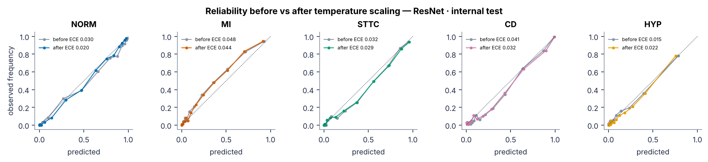
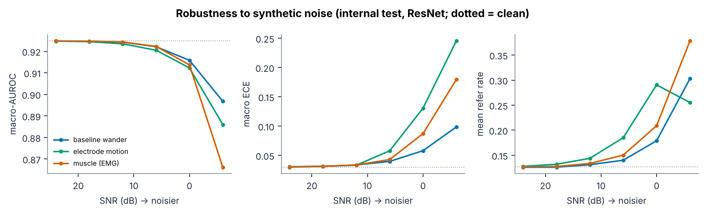
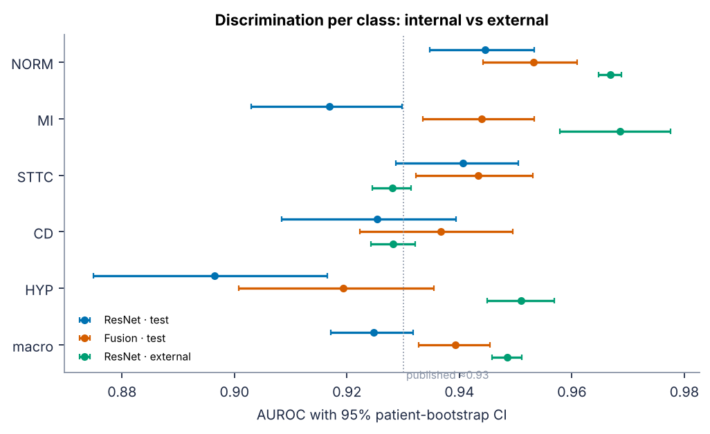
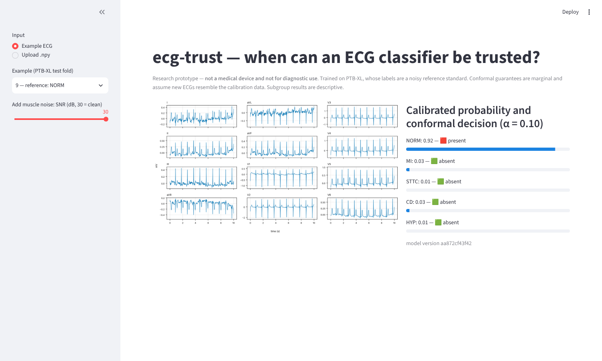
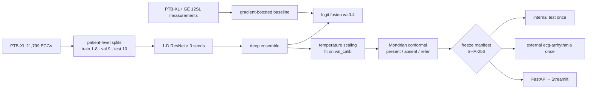

# ecg-trust: when can a 12-lead ECG classifier be trusted?

A 12-lead ECG classifier for five diagnostic superclasses:

| code | superclass |
|---|---|
| NORM | normal |
| MI | myocardial infarction |
| STTC | ST/T change |
| CD | conduction disturbance |
| HYP | hypertrophy |

The project asks how much the classifier can be trusted, not only how accurate it is. It checks three things:
- whether its probabilities are calibrated;
- whether it says "I don't know" (refers the ECG to a cardiologist) at a rate it can guarantee;
- whether it holds up on noisy signals and on a different hospital population.

It is trained on PTB-XL and frozen before any test data was touched. It was tested once on the PTB-XL test fold and once on 28,646 external ECGs from China. It is compared against the GE 12SL algorithm used in commercial ECG carts.

> Research prototype. **Not a medical device and not for diagnostic use.**

## Headline results

<!-- generated by `ecgtrust readme-tables`; do not edit by hand -->
| Evaluation set | n | Macro-AUROC [95% CI] | Macro ECE (before → after scaling) | Refer rate at α = 0.10 | Coverage (pos / neg) |
|---|---|---|---|---|---|
| Internal test (PTB-XL fold 10), ResNet ensemble | 2158 | 0.925 [0.917, 0.932] | 0.033 → 0.030 | 12.7% | 0.902 / 0.901 |
| Internal test, ResNet + 12SL fusion | 2158 | 0.939 [0.933, 0.945] | 0.021 → 0.021 | 9.5% | 0.905 / 0.902 |
| External (ecg-arrhythmia, strict map) | 28646 | 0.949 [0.946, 0.951] | 0.082 → 0.086 | 11.4% | 0.920 / 0.893 |

Reading the table:
- **Published reference:** the best PTB-XL superdiagnostic benchmark is ≈0.93 macro-AUROC (Strodthoff et al., *IEEE JBHI* 2021, doi:10.1109/JBHI.2020.3022989). It was not re-run here.
- **Confidence intervals:** patient-level bootstrap, 2,000 resamples.
- **Coverage:** the share of true positives (or true negatives) that the conformal set keeps. The target is 0.90 at α = 0.10.
- **Full report:** [`reports/results.md`](reports/results.md).

| Calibration (internal test) | Robustness to noise | Internal vs external |
|---|---|---|
|  |  |  |

64 more figures, covering data, training, explainability and the 12SL comparison, are indexed in [`reports/figures/`](reports/figures/README.md). The 21-page illustrated guide is [`reports/guide/ecg_trust_guide.pdf`](reports/guide/ecg_trust_guide.pdf).

## What I found

- **The deep model beats the commercial algorithm, and fusion helps further.**
  - At the GE 12SL algorithm's own specificity, the ResNet ensemble is 7.6 to 26.9 points more sensitive across the five classes. For MI the confidence interval crosses zero.
  - Fusing the ResNet with 12SL's own measurements raises internal macro-AUROC from 0.925 to 0.939. All five 12SL gaps then exclude zero (+15 to +27 points).
- **The guarantees hold inside the population and erode outside it.**
  - On the internal test set, conformal coverage hits its target (0.902 for positives at a 0.90 target) with 12.7% of ECGs referred.
  - On the external Chinese cohort, ranking stays strong (0.949) but calibration degrades: ECE rises from 0.030 to 0.086.
  - Coverage of positives drops to 0.88 for NORM, STTC and CD. That is the expected failure of an exchangeability-based guarantee under population shift.
- **Noise robustness is good until it isn't.**
  - Macro-AUROC falls only from 0.925 to 0.912–0.916 at 0 dB SNR for baseline wander, muscle and electrode-motion noise.
  - At −6 dB electrode motion, ECE rises to 0.245 while the refer rate *falls*. The model becomes confidently wrong instead of abstaining.
  - So a signal-quality gate is needed in front of the model.

The explainability results agree with clinical criteria (integrated gradients on validation ECGs):

| Class | Lead it relies on most | Clinical basis |
|---|---|---|
| HYP | V5 | R-wave voltage criteria |
| CD | V1 | bundle-branch morphology |
| MI | V1–V2 | Q waves in these leads |

## Quickstart

```bash
pip install torch --index-url https://download.pytorch.org/whl/cpu
```

```bash
pip install -e ".[serve,dev]"
```

```bash
ecgtrust download --dataset ptbxl        # then ptbxl_plus and external; ~10 GB, checksum-verified
```

```bash
ecgtrust prepare                       # splits + 100 Hz signal caches
```

```bash
ecgtrust audit
```

```bash
ecgtrust train --model baseline --features 12sl
```

```bash
ecgtrust train --model resnet          # 3 seeds; ~2 h on 4 CPUs, minutes on a GPU
```

```bash
ecgtrust train --model fusion
```

```bash
ecgtrust evaluate --split val_select
```

```bash
ecgtrust freeze                        # hashes checkpoints, configs and label maps
```

```bash
ecgtrust evaluate --split test         # single use; repeats need --rerun-reason
```

```bash
ecgtrust evaluate --split test --model fusion
```

```bash
ecgtrust evaluate --split external
```

```bash
ecgtrust results
```

```bash
ecgtrust figures
```

```bash
ecgtrust release
```

```bash
ecgtrust guide
```

To serve the frozen model:

```bash
uvicorn ecgtrust.serve.api:app --port 8000      # POST /predict or /predict/npy
```

```bash
streamlit run app/streamlit_app.py              # demo UI
```



A Google Colab (GPU) version of the whole pipeline is in [`colab/`](colab/).

## How it fits together



## Limitations and non-claims

- **Labels are noisy.** PTB-XL labels come from one or two cardiologists. 12SL's sensitivity of about 0.55 here partly reflects how its statements were mapped to the five superclasses (published in `configs/12sl_label_map.csv`).
- **The external AUROC is not a claim of better generalisation.** The strict SNOMED map keeps only clear-cut diagnoses, and MI has only 204 positives (0.7%). The liberal map gives 0.903–0.961 per class.
- **The fusion model is PTB-XL only.** It needs GE 12SL measurements. The served model and the external evaluation are ResNet-only.
- **Conformal guarantees are marginal and assume exchangeability.** They broke under the external shift, as shown above.
- **Subgroup differences are descriptive.** Examples: STTC AUROC is lower at 80–89 years than at 40–59, and varies across recording devices. These are not causal claims.
- **No GPU was used.** All results come from CPU training. The Docker image is defined but could not be built in this session: no Docker daemon was available.

## Data and citations (all CC BY 4.0)

- Wagner P, et al. PTB-XL, a large publicly available electrocardiography dataset. *Sci Data* 7, 154 (2020). doi:10.1038/s41597-020-0495-6. PhysioNet v1.0.3.
- Strodthoff N, et al. PTB-XL+, a comprehensive electrocardiographic feature dataset. *Sci Data* 10, 279 (2023). doi:10.1038/s41597-023-02153-8. PhysioNet v1.0.1.
- Zheng J, Guo H, Chu H. A large scale 12-lead electrocardiogram database for arrhythmia study (v1.0.0). PhysioNet (2022); built on Zheng J, et al. *Sci Data* 7, 48 (2020).
- Goldberger A, et al. PhysioBank, PhysioToolkit, and PhysioNet. *Circulation* 101(23), e215–e220 (2000).

## Deploying the demo to Streamlit Community Cloud

1. Push this repository to GitHub. `release/` (18 MB) and `app/examples/` are committed, so no data download is needed.
2. On share.streamlit.io, choose **New app**.
3. Point it at `ecg-trust/app/streamlit_app.py` with Python 3.11.
4. Add a `requirements.txt` containing `torch` (CPU), `-e .[serve]` and `streamlit`.

See [`MODEL_CARD.md`](MODEL_CARD.md) for intended use and evaluation details.
